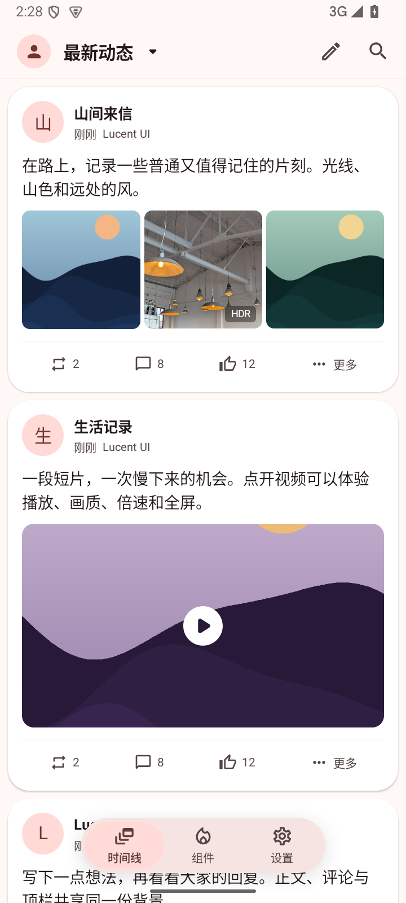
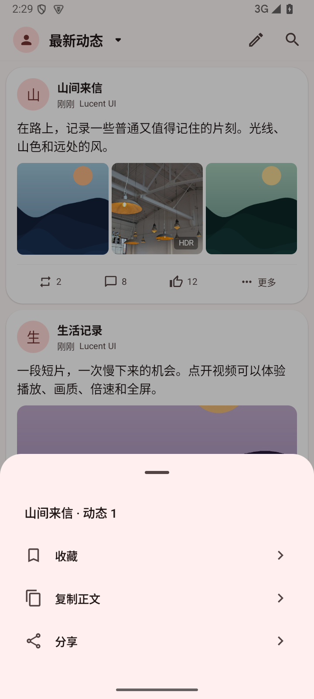
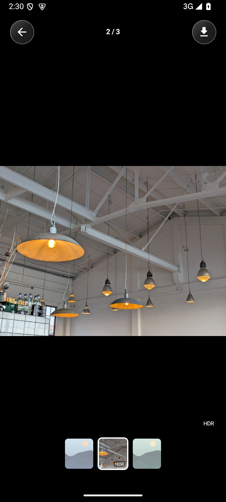
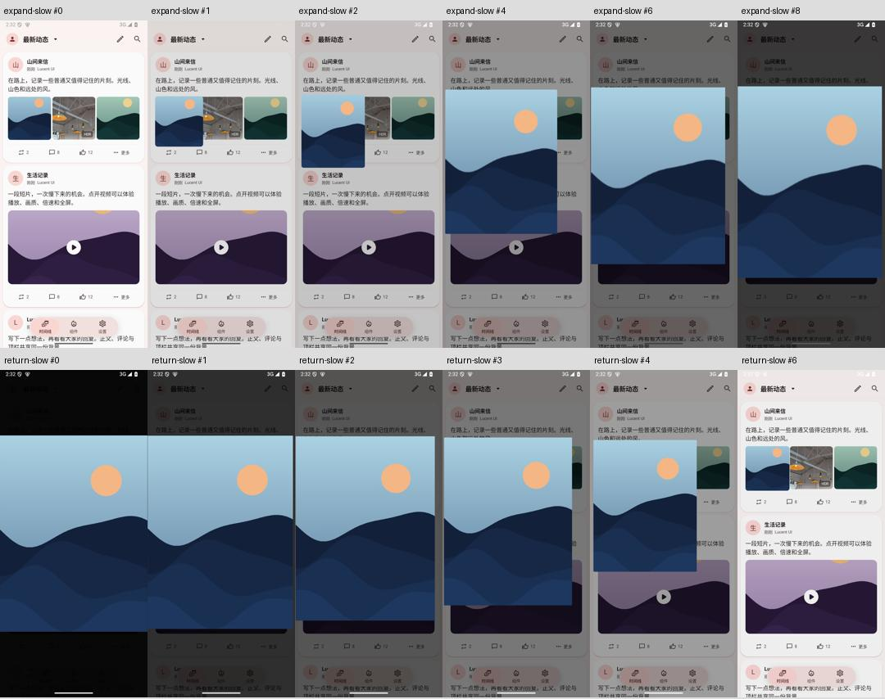

# 0.2.1 图片与菜单运行证据

Android15 API35隔离模拟器，720×1600，原签名ARM64正式包；没有操作用户手机。

[默认速度展开/缩回及重复打开录屏](evidence/gallery-0.2.1/gallery-normal.mp4)。图库进入330ms/返回200ms。

为观察中间帧临时使用5倍系统动画时长，检查后删除临时设置并恢复系统默认；默认速度视频独立录制。连续帧说明图片从实际来源移动，不是普通页面推入。返回途中点同一原位会重新打开，没有进入父文章。

运行通过：时间线3张图片对应正确索引、正文直接展开和返回、图库目录长图缩放/GIF播放/HDR标签、横滑切图、快速重开、保存取消返回图库。GIF相隔时间截图的内容像素有变化，长图双击放大后画面像素有变化。菜单打开和关闭不收藏；选择收藏后重启保留，再取消可恢复；复制正文在搜索框粘贴核对一致，分享打开系统选择器。

HDR文件在Android15原尺寸和2/4倍采样解码均hasGainmap=true，未将普通JPEG伪标为HDR。真实HDR屏幕亮度、低版本设备和实体触感未验收。最终包及检查范围见[verification.json](verification.json)。
