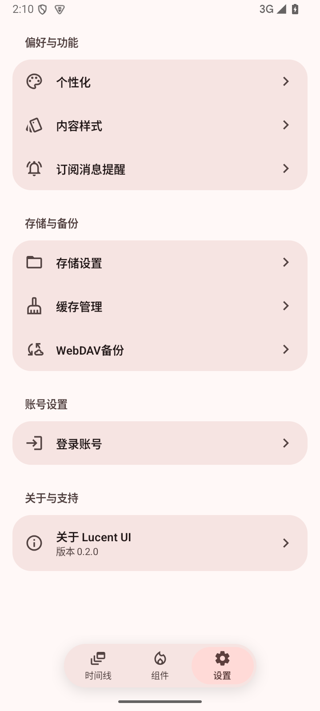
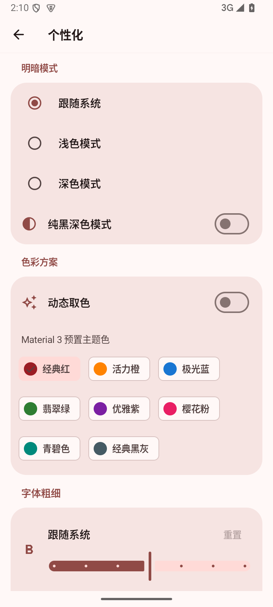
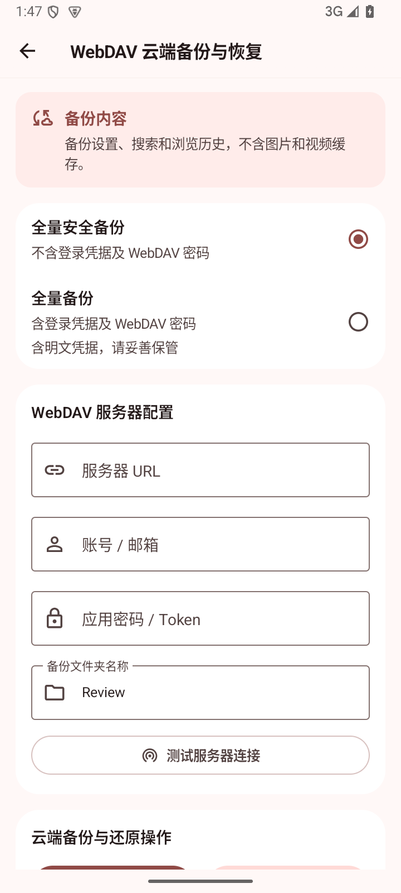
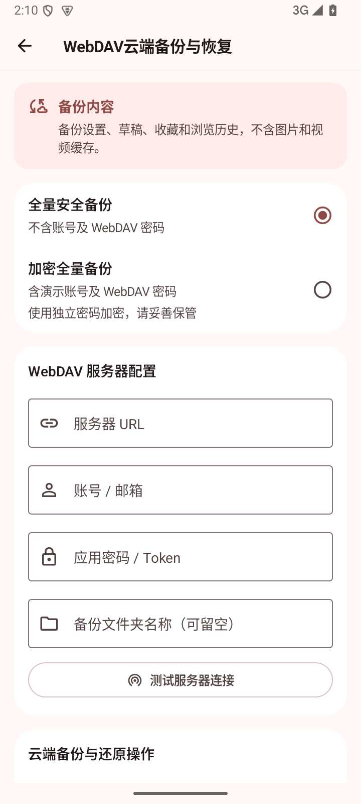

# Review 与 Lucent UI 实机界面对照

[打开并排对照页](visual-review.html)

同一台Android15模拟器，720×1600、100%字号。左侧Review 3.17.5+278，右侧Lucent UI 0.2.0+2。截图来自正式安装包，原应用源码未修改。

| 页面 | Review | Lucent UI |
|---|---|---|
| 设置首页 |  |  |
| 个性化 |  |  |
| WebDAV |  |  |

设置首页卡片、分组及导航几何已对齐；个性化使用同一原组件，预览文案更换为Demo名称。WebDAV布局采用Review，保留Demo独立加密密码输入，不承诺两者备份格式互通。

实际运行补充：

- [动态取色与深色卡片](screenshots/lucent-appearance-dynamic-dark.png)
- [液态玻璃底栏](screenshots/lucent-settings-glass-dark.png)
- [图库](screenshots/lucent-gallery.png)
- [视频](screenshots/lucent-video.png)
- [评论磨砂采样](screenshots/lucent-comments-frost.png)
- [缓存管理](screenshots/lucent-cache.png)

未在真实Review账号下完成图库/视频/评论的同内容像素对照；这些区域依据当前源码适配和Demo运行检查。实体GPU、触感、HDR及低版本Android仍未实机验收。

字号检查：[个性化150%](screenshots/lucent-font-150.png) · [设置150%](screenshots/lucent-settings-150.png)。最终交付包与模拟器已安装APK的SHA-256相同。
